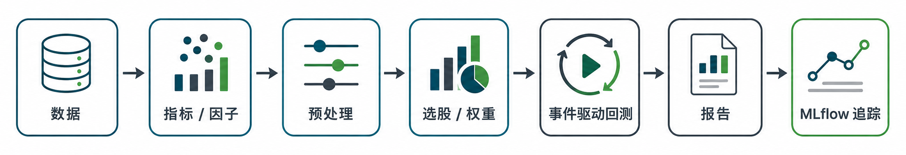

<p align="center">
  
</p>

<p align="center">
  <a href="https://muuyesen.github.io/trade-learn/"><b>Documentation</b></a> |
  <a href="CHANGELOG.md"><b>Changelog</b></a> |
  <a href="./README.md"><b>中文简体</b></a> |
  <a href="./README_ja.md"><b>日本語</b></a>
</p>

<p align="center">
  <strong>Python for Strategy & Research, Rust for Event-Driven Backtest Engine.</strong>
</p>

<p align="center">
  
  
  
  
  <a href="https://discord.gg/JbqZ7p33ra"></a>
</p>

**trade-learn** aims to eliminate the long-standing friction between quantitative research ("Learn") and backtest execution ("Trade"). By adopting a hybrid architecture of "Python for strategy logic + Rust for native backtest core," it achieves a **110x+ performance leap** in multi-asset backtesting with the declared Backtrader semantics checked against fixed fixtures. These benchmark results apply to the fixed samples below, not every strategy, platform or live execution path; it shortens large research runs, providing truly iterative research efficiency for index enhancement and machine learning strategies.

Beyond high performance, **trade-learn** provides a complete research infrastructure. With built-in **JupyterLab** and **MLflow**, it seamlessly links factor mining, strategy validation, and experiment auditing into a **reproducible, traceable, and auditable** full-lifecycle research pipeline. This elevates the research process from "result-oriented" to a systematically managed engineering workflow, allowing researchers to focus on the core strategy logic.

<p align="center">
  
</p>

**From Extreme Efficiency to Scientific Decision-Making**: Building on the efficiency gains of the research pipeline, **trade-learn** further addresses the core "scientific rigor" of quantitative research. To combat the "pseudo-correlation" risks common in machine learning strategies, we have deeply integrated **Causal Inference** into the research workflow. By identifying true causal driving paths, it reduces out-of-sample decay risks and helps build highly explainable and robust quantitative strategy systems.

## Implementation Path

**trade-learn** rejects the simple stacking of features. Instead, it balances professional depth with research efficiency through a unique "Dual-Mode, Dual-Core" design. The **Engine** layer strictly aligns with Backtrader semantics for logic correctness, while the **Lite** layer provides a minimal Pythonic interface for rapid iteration.

You can define the depth of your strategy based on the research stage:
- **Engine Mode (Deep Research)**: Fully aligns with Backtrader semantics, supporting the complete Analyzer/Sizer/Signal ecosystem. Ideal for building complex backtest strategies with precise logic.
- **Lite Mode (Agile Validation)**: Follows the minimalism of `backtesting.py`, supporting direct connection to model weights. Perfect for high-frequency iteration and prototype validation during the factor mining stage.

In terms of ecosystem, **trade-learn** provides comprehensive indicator support, compatible with TA-Lib, TDX, and TradingView/PyneCore, while allowing flexible expansion of custom indicators and data sources.

## Core Highlights

#### ⚡️ High-Performance Core: Rust-Driven Velocity
- **Rust Hybrid Power**: The matching engine and core calculations are powered by Rust, providing **28x** speedup for single assets and **110x+** for multi-asset rebalancing compared to Backtrader.
- **Automatic Runner Scheduling**: Automatically selects between "Single-Stream Bar-by-Bar" or "Batch Panel" processing based on data shape. Optimized memory layout for **Index Enhancement** scenarios.

#### 🛡️ Rigorous Finance: Backtest Semantics Checked Against Backtrader
- **Engine-Level Alignment**: Full support for the Analyzer/Sizer/Signal system, ensuring zero logical divergence from the Backtrader Oracle.
- **Lite Minimalist Expression**: Lightweight syntax built on the same runtime. Features a built-in `target_weights` interface to convert ML model outputs into backtest decisions instantly.

#### 🧪 Causal Research: Scientific Workflow Beyond Correlation
- **Causal-First Feature Selection**: Built-in causal discovery algorithms like PC/FCI to identify true causal paths and combat "pseudo-correlation" and overfitting.
- **Full-Link Pipeline**: Seamlessly couples feature engineering, causal screening, scoring models, portfolio weights, and backtest reports into a reproducible experimental loop.

#### 📦 Modular Platform: Lightweight Core, On-Demand Expansion
- **Decoupled Core**: The default installation includes Engine, Lite, and basic data handling; reports, factors, Parquet, ML, and indicator backends are optional extras.
- **Elastic Expansion**: One-click activation of the integrated research environment (**JupyterLab + MLflow + AI Assistant**) via `[research]` extras.

#### 🌍 Global Vision: Multi-Standard Indicators & Modern Ecosystem
- **Dual-Market Standards**: Explicit support for TDX (China) and TradingView (International) indicator standards, with persistent TA-Lib state handles.
- **Modern Tools**: Out-of-the-box HTML interactive reports, MLflow experiment tracking, and JupyterLab / AI Lite / Skills research environment.

## Causal Quant: Bridging the "Pseudo-Correlation" Trap

Most quantitative research stops at **Correlation**, which often leads to factors performing well in backtests but failing rapidly in live trading (overfitting). trade-learn helps you identify the true drivers of returns through its built-in **Causal Discovery** mechanism:

- **Causal Feature Selection**: Use `CausalSelector` with PC/FCI algorithms to strip away pseudo-correlated factors caused by "common observations," keeping only features with direct driving capability for returns.
- **Resisting Out-of-Sample Decay**: Alpha factors identified via causal graphs are more resilient to market regime shifts, effectively reducing the performance gap between research and live trading.
- **Industrial Integration**: Deeply integrated with the `causal-learn` ecosystem, making advanced causal inference as seamless as calling `corr()`.

## Who is it for?

*   **Agile Developers & Prototypers**: Convert ideas into backtest reports in just a few lines of code, enjoying a `backtesting.py`-like lightweight experience.
*   **Index Enhancement & Portfolio Managers**: Simulate rebalancing for 1000+ assets in seconds using the Rust Panel Runner.
*   **ML & Factor Researchers**: A one-stop automated loop from feature engineering and **Causal Discovery** to MLflow-tracked model training and backtesting.
*   **Backtrader Power Users**: Modernize your reporting and speed up your research while retaining the mature event-driven semantics you trust.
*   **Cross-Market & Multi-Strategy Teams**:
    *   **Cross-market consistency**: Cover A-shares (TDX) and global markets (TradingView) with consistent indicator standards and reporting.
    *   **Unified strategy operations**: Manage rule-based and model-based strategies in one stack, avoiding fragmented research and maintenance workflows.
*   **Causal Inference Explorers**: Bring causal graph methods into factor selection to remove pseudo-correlations and build more explainable, robust quantitative systems.

Causal/ML research remains part of the strategy workflow. See the [causal guide](docs/guides/causal.md) for explicit target routing, temporal boundaries, graph/report semantics and the unreleased AutoML migration.

## Installation

This section targets `0.3.4`, frozen at `v0.3.4`/`5af840c`. A tag is not proof of a completed upload: use these commands only when [PyPI 0.3.4](https://pypi.org/project/trade-learn/0.3.4/) is available. Existing 0.3.2 artifacts remain immutable.

```bash
pip install trade-learn==0.3.4
# Official NA and cTrader require CPython 3.13 or 3.14.
pip install "trade-learn[nautilus,tl-store]==0.3.4"
pip install "trade-learn[research]==0.3.4"
```

The unified lock is resolved and CI-qualified. `[tl-store]` pins public `tl-store==0.2.1a8`; `[nautilus]` pins official `nautilus_trader==2.0.0rc7`. Other Python versions skip NA through metadata markers and cannot run the bridge. The base import is inert. Research includes Jupyter AI Lite/Skills and local MLflow recording; the CLI exposes only `new/lab/doctor`, help and version, without extra service orchestration.

Real TL wheels cover macOS arm64/Windows AMD64/Linux x64 CP310–314 and Linux ARM64 CP313. Fresh Linux CP313+Storea8+NA2rc7 installation, RECORD/native/pip-check and the actual Mac CP313 candidate have been qualified. Other Store platform builds and natural venue behavior are separate. KQ Windows integration is unimplemented and Linux ARM remains unverified; this is not a claim that TL itself lacks those OS targets.

The public path is `from tradelearn import engine as bt`, lazy `bt.stores.NautilusStore`, ordinary `bt.Strategy`/`bt.talib.SMA`, standard broker/data/strategy assembly and only `cerebro.run(monitor=...)`. No public `Store.run`, internal runtime import or SDK strategy superclass is required. Monitor exposes endpoint and an access-key pair only; trusted binding failure retains local files. See the [frozen template](https://github.com/MuuYesen/trade-learn/blob/d202cc1ab0dfd25f3ada8b25eba3315a84a2e27c/examples/live/ctrader_monitor.py) and [corrected 0.3.4 changelog](CHANGELOG.md). Real Sender/archive roundtrip remains a separate, unqualified integration gate.

## Quick Start

These examples use indicator providers and reports: install `.[research]` first.

**Lite — The Shortest Path** (Ideal for rapid validation, teaching, and target-weight portfolios):

```python
import tradelearn.lite as tl
from tradelearn.data import TradingViewProvider

class LiteSmaCross(tl.Strategy):
    fast = 10
    slow = 20

    def init(self):
        self.fast_ma = tl.tdx.MA(self.data.close, N=self.fast)
        self.slow_ma = tl.tdx.MA(self.data.close, N=self.slow)
        self.addminperiod(self.slow + 2)

    def next(self):
        if self.fast_ma[0] > self.slow_ma[0] and not self.position():
            self.buy(size=100)
        elif self.fast_ma[0] < self.slow_ma[0] and self.position():
            self.position().close()

provider = TradingViewProvider(n_bars=5000)
bars = provider.history_ohlc("NASDAQ:AAPL", start="2023-01-01", end="2024-01-01")

bt = tl.Backtest(bars, LiteSmaCross, cash=100_000, commission=0.0003, trade_on_close=True)
stats = bt.run()

print(stats.summary)
bt.plot()
bt.report("report.html")
```

> [!TIP]
> **Multi-asset logic:** In multi-asset backtests, the strategy binds to `self.data` by default (the primary data feed). The example above therefore makes decisions from the first asset even if multiple assets are provided. To trade multiple assets independently, iterate over `self.datas` in `init` and create indicators for each feed.

**Engine — Backtrader Style** (For complex portfolios; external hosts drive paper/live execution):

```python
import tradelearn.engine as bt
from tradelearn.data import TradingViewProvider
from tradelearn.indicators import tdx

class SmaCross(bt.Strategy):
    params = (("fast", 10), ("slow", 20))

    def __init__(self):
        self.fast = tdx.MA(self.data.close, N=self.p.fast)
        self.slow = tdx.MA(self.data.close, N=self.p.slow)

    def next(self):
        if not self.position and self.fast[0] > self.slow[0]:
            self.buy(size=100)
        elif self.position and self.fast[0] < self.slow[0]:
            self.close()

provider = TradingViewProvider(n_bars=5000)
bars = provider.history_ohlc("NASDAQ:AAPL", start="2023-01-01", end="2024-01-01")

cerebro = bt.Cerebro()
cerebro.broker.setcash(100_000)
cerebro.broker.setcommission(commission=0.0003)
cerebro.broker.set_coc(True)
cerebro.adddata(bt.feeds.PandasData(dataname=bars), name="AAPL")
cerebro.addstrategy(SmaCross)

[strategy] = cerebro.run()
print(strategy.stats.summary)

cerebro.plot()
from tradelearn.report import Reporter
Reporter(strategy.stats).report("report.html")
```

> [!TIP]
> **Multi-asset logic:** In multi-asset backtests, the strategy binds to `self.data` by default (the primary data feed). The example above therefore makes decisions from the first asset even if multiple assets are provided. To trade multiple assets independently, iterate over `self.datas` in `init` and create indicators for each feed.

## Intended use

TradeLearn is intended for research and backtesting. We do not recommend using it for live trading. Backtest results do not guarantee future performance.

## Research Pipeline Example

The maintained [Lite pipeline](examples/research/index_enhance_lite_pipeline.py) and [Engine pipeline](examples/research/index_enhance_engine_pipeline.py) share the fitted research workflow. They use actual label_end for purge, independent preprocessing columns, explicit ResearchRun registration/calls and a complete local deployment bundle. Reports and `tradelearn.integrations.mlflow.log` consume completed results. Model publication and attachments remain explicit.

See the [research guide](docs/guides/research.md) and [MLflow guide](docs/guides/mlflow-lab-mcp.md). Data acquisition and inference use the examples' explicit CLI inputs; no implicit provider/paid model or live strategy starts from importing them.

## Alignment & Performance

Local baselines focus on two core checks: **whether results align** and **whether throughput is meaningfully faster than Backtrader**. Full reproduction commands are available in [benchmarks](docs/benchmarks.md).

#### 1. Single-Asset High-Frequency: SMA Cross (550k Bars)
* **Strategy idea**: Run a standard dual moving average crossover. This stresses Rust's event-driven state maintenance and single-stream throughput over a long sequence.

| Engine Mode | Time | Throughput (Bars/s) | **Speedup** | Final Equity | Orders | Closed Trades | Status |
|---|---|---|---|---|---|---|---|
| **Tradelearn Lite** | **1.32s** | **414,990** | **27.9x** | **118,399.33** | 10,299 | 5,149 | **EXACT** |
| **Tradelearn Engine** | **3.37s** | **162,883** | **11.0x** | **118,399.33** | 10,299 | 5,149 | **EXACT** |
| Backtrader (Oracle) | 37.02s | 14,854 | 1.0x | 118,399.33 | 10,299 | 5,149 | - |

#### 2. Large-Scale Index Enhance: Top-50 Target Weights (5.04M Bars)
* **Strategy idea**: Simulate full-market stock selection and rebalancing across 1000 assets. This stresses Rust's panel-data memory layout and large-scale ML research workflow.

| Engine Mode | Time | Throughput (Bars/s) | **Speedup** | Final Equity | Completed Orders | Rebalance Intents | Rebalances |
|---|---|---|---|---|---|---|---|
| **Tradelearn Lite** | **2.40s** | **2,094,237** | **119.1x** | **4,199,638.26** | 23,249 | 23,249 | 239 |
| **Tradelearn Engine** | **4.11s** | **1,225,594** | **69.7x** | **4,199,638.26** | 23,249 | 23,249 | 239 |
| Backtrader (Oracle) | 286.53s | 17,589 | 1.0x | 4,199,638.26 | 23,249 | 23,249 | 239 |

## Parity Commitment

**trade-learn** treats "benchmark parity" as a core engineering discipline. Every computed result must withstand strict scrutiny, with numerical alignment maintained across these layers:

*   **Financial metrics parity**: `metrics` (Sharpe, MaxDD, Sortino, etc.) match `empyrical` within `rtol=1e-10`.
*   **Multi-source indicator parity**:
    *   `tl.tdx` (TDX semantics) matches `MyTT` within `rtol=1e-10`.
    *   `tl.tv` (TradingView semantics) matches `pyneCore` within `rtol=1e-6`.
*   **Backtest engine parity**:
    *   **Decision layer**: trade records (**Trades**) match the official Backtrader implementation with **0 difference** in time, direction, and position.
    *   **Equity layer**: equity curves align within `rtol=1e-6`, and summary statistics align within `rtol=1e-4`.

> [!IMPORTANT]
> We treat every numerical deviation with zero tolerance. All differences are registered and explained. See [design notes → semantic consistency audit](docs/internals/consistency.md).

## Full Documentation

*   **Official online docs**: [**https://muuyesen.github.io/trade-learn/**](https://muuyesen.github.io/trade-learn/)
*   **Local technical manual**: [`docs/`](docs/README.md)

| Topic | Entry |
|---|---|
| First backtest in 30 lines | [Quickstart](docs/quickstart.md) |
| Lite / Engine usage | [Lite Guide](docs/guides/lite.md) · [Engine Guide](docs/guides/engine.md) |
| Architecture and boundaries | [Architecture](docs/concepts/architecture.md) |
| Factor / ML / weight research pipeline | [Research Guide](docs/guides/research.md) |
| Dual-standard indicators (`tl.talib` / `tl.tdx` / `tl.tv`) | [Indicators Guide](docs/guides/indicators.md) |
| Performance baseline | [Benchmarks](docs/benchmarks.md) |
| Kernel internals (contracts / matching / portfolio / event loop) | [Design Notes](docs/internals/contracts.md) |
| Full API | [API Reference](docs/api/reference.md) |

## 🚀 Roadmap

Based on the current engineering plan, **trade-learn** evolves along these core dimensions:

#### Backtest Engine & Core Foundation
- [x] **Rust Hybrid Kernel**: Clocked Multi-Data Runner, **110x+** speedup for multi-asset backtests.
- [x] **Backtrader Semantic Parity**: Declared matching cases and shared runtime through `bt.Strategy`.
- [x] **Index Enhancement Pipeline**: Complete `Data → Factor → Score → Weights → target_weights()` workflow.
- [x] **Automated Experiment Audit**: Deep MLflow integration for code snapshots, parameters, metrics, and reports.
- [x] **High-Performance Data Backend**: **DuckDB native connector has landed**, supporting local second-level reads and cross-dimensional queries over hundreds of millions of bars.
- [ ] **Risk Model Integration**: Barra-style risk exposure analysis and excess-return attribution.

#### Scientific Research Capabilities
- [x] **Causal Discovery Foundation**: Integrated `CausalSelector` (PC/FCI) to identify true alpha drivers during feature engineering.
- [ ] **Algorithm Expansion**: Add GIES, Direct-LiNGAM, and other advanced algorithms for better explainability and stability.
- [ ] **Causal Closed Loop**: Automate the loop across causal analysis, parameter optimization, and risk control.

#### Agent & AI Capabilities
- [x] **Research entry points**: new/lab/doctor and version-matched AI Lite Skills. TL MCP is retired; provider qualification is tracked separately.
- [ ] **Agentic Strategy Diagnosis**: Use LLMs to analyze backtest results, identify loss drivers, and suggest logic improvements.
- [ ] **LLM Factor Interpreter**: Translate causal discovery results into intuitive financial investment logic.

#### Engineering & ML Lifecycle
- [x] **Model Registry**: **MLflow-based model registry** for full-lifecycle tracking of feature fingerprints and model versions.
- [ ] **Distributed Parameter Optimization**: Multi-machine parameter search and Monte Carlo simulation via Ray / Optuna.

#### Live Trading & Ecosystem Vision
- [x] **Universal Live Event Link**: Shared `StrategyRuntime` lifecycle for default research, event replay, and external paper/live hosts; execution outcomes depend on the broker and input schedule.
- [x] **Optional Execution Host**: Common Nautilus bridge and optional logging; each venue, order capability and production deployment still needs validation. Private adapters and credentials are not shipped.
- [ ] **Agentic Quant Platform**: Evolve into a natural-language-driven automation foundation for end-to-end quantitative research.

## Disclaimer

This project is for academic research and technical exchange only and does not constitute any investment advice. Quantitative trading involves high risk; past performance is not indicative of future results. The developers are not responsible for any financial losses incurred through the use of this project. Invest at your own risk.

## Acknowledgements

[Quantopian](https://github.com/quantopian) · [Trevor Stephens](https://github.com/trevorstephens) · [PyWhy](https://github.com/py-why) · [dodid](https://github.com/dodid) · [DolphinDB](https://github.com/dolphindb) · [happydasch](https://github.com/happydasch) · [mpquant](https://github.com/mpquant) · [baobao1997](https://github.com/baobao1997)

## Contact

WeChat: 知守溪的收纳屋 · Email: muyes88@gmail.com
