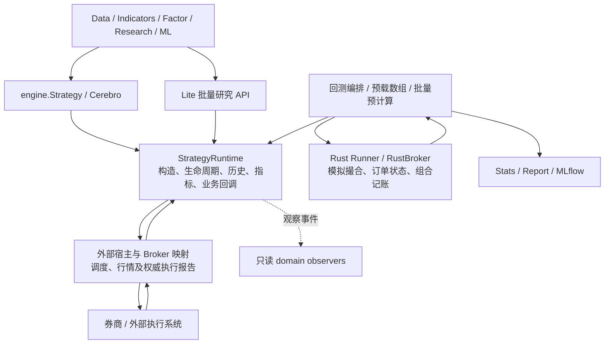

# 架构与边界

当前源码版本为 **0.2.9（未发布候选）**。TradeLearn 使用 Python 表达策略与研究流程，使用 Rust 支撑原生回测内核，并通过公开 `engine.StrategyRuntime` 协调默认研究、事件回放和外部驱动的 paper/live 生命周期。

## 全景架构图

图中外部宿主、券商及其生产配置不随公共包交付。`StrategyRuntime` 本身不启动常驻事件循环、不连接券商、不执行模拟撮合。

## 各层职责

| 层 | 职责 | 边界 |
|---|---|---|
| Engine facade | Backtrader 风格的 Strategy、Cerebro、指标、Analyzer、Sizer 及 Runtime 入口 | 用户优先从 `tradelearn.engine` 导入 |
| Lite facade | 轻量策略、目标权重和批量研究 | Lite.I 保留批量语义，增量 Runtime 不支持完整 Lite profile |
| StrategyRuntime | 策略构造、参数绑定、生命周期、行情历史、暖机、指标推进和业务通知 | 同步执行，由调用方提供时钟、市场事件和 broker 事实 |
| Python 回测编排 | 数据预载、批量指标预计算、runner 选择、结果收集 | 委托同一 Runtime 调用业务，不另建生命周期 |
| Rust 回测内核 | 回测时钟推进、模拟撮合、订单与组合状态 | RustBroker 仅用于回测；不能当成实盘账户或真实成交 |
| 外部执行宿主 | 调度、券商连接、订单提交、权威回报及恢复保护 | 由独立集成提供；公共 TL 不依赖某个执行平台 |
| Observers | 只读观察生命周期、业务和意图事件 | 不提供商业 SDK、可靠日志存储、网络发送或第二份成交事实 |
| 研究与报告 | 数据整理、因子、模型、研究追踪和结果导出 | 可独立使用；扩展依赖按 extras 安装 |

Python/Rust 扩展由 maturin/PyO3 构建，数组及绑定实现以源码为准，不把所有交互概括成 Arrow 零拷贝。原生回测所需扩展必须与 Python 包版本、平台及 Python ABI 匹配。

## 研究与实盘共享的范围

默认 Cerebro/Backtest（包括 Lite 批量 profile）、EventRunner 事件回放和 Cerebro paper/live 使用同一策略协调器。共享构造、生命周期、指标推进与业务回调，不等于模拟成交和真实成交相同。

默认批量研究按同时间戳的 active bars 合步；标准增量路径按调用方实际交付顺序消费。相同 OHLCV 不代表相同调度输入。严格对照须固定行情分组、到达顺序、执行报告及撮合假设。显式 `step_market_batch` 可以表达调用方声明的同时间原子批次，Runtime 不会自动等待缺失标的。

增量指标的历史保留、完整 prefix 函数计算成本和限制见 [Runtime 契约](runtime.md#正式增量策略runtime)。批量研究的预计算不能被描述为任意函数的固定低延迟实盘实现。

## Nautilus 与外部集成

[NautilusTrader](https://github.com/nautechsystems/nautilus_trader) 是独立的公开项目。外部集成可以安装并导入其公开工具包、节点及适配器，把行情和执行报告映射到 TL Runtime，再把策略意图交给 Nautilus 执行。

**公共 TL 无必需 Nautilus 依赖，不代表采用 Nautilus 的实盘部署不需要安装它。** 依赖应由使用该能力的集成包或部署环境声明，并核验版本、平台和所需适配器。当前公共仓库没有随包交付可独立安装的 Nautilus 桥接包；工作区私有桥接还依赖外部监控 SDK，不能仅安装上游包就视为已获得完整接入。本地自研或修改的适配器也不能假定存在于上游发行包。

账户、凭据、生产策略、部署配置及商业监控实现由各自项目维护。公共库保持自包含，不引用工作区私有路径。

## 验证与版本状态

Backtrader oracle、golden 和基准用于核验指定输入与已声明语义；通过某组样本不代表所有 API、所有策略或实盘成交都完全等价。历史性能数字以[基准说明](../benchmarks.md)的环境及输入为限。

源码同步、构建 wheel、发布 PyPI、部署和券商验收是不同步骤。0.2.9 源码说明不表示这些步骤已完成。

## 相关阅读

- [快速开始](../quickstart.md)
- [API 边界](api-boundary.md)
- [Runtime 与 Runner](runtime.md)
- [Strategy observers](../guides/strategy-observers.md)
- [paper/live 接入](../guides/live.md)
- [内部契约](../internals/contracts.md)
