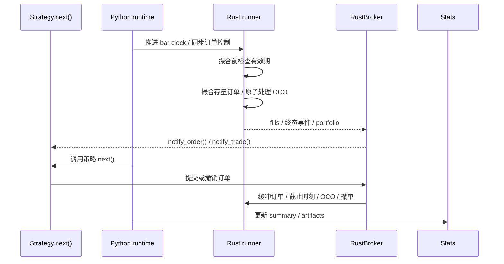

# Runtime 与 Runner

trade-learn 是事件驱动回测框架，不是纯向量化回测器。策略仍然在每根 bar 上通过 `next()` 表达逻辑，runtime 负责把当前 bar、订单、成交、持仓和权益状态推进下去。

## 自动 runner 选择

| 场景 | 自动路径 | 触发条件 |
|---|---|---|
| 单标的 | Rust single-data runner | `RustBroker` 已绑定 Rust engine，且只有 1 个 data feed |
| 多标的 | Rust multi-data clock runner | `len(datas) > 1`，每个 feed 暴露 OHLCV 数组 |
| 自定义 feed / 非 Rust broker | Python fallback | 不满足数组协议或 broker 条件 |

用户不需要显式选择 runner。Engine 和 Lite 都通过 `tradelearn.backtest` runtime 进入同一套内核。

Python runner fallback 不等于 `RustBroker` 撮合降级：默认 `RustBroker` 缺少 Rust 扩展时会明确报错，不会静默改用 Python 撮合，也不会继续调用策略 `next()`。

触发条件的具体口径：

- **single-data runner**：只有一个数据源时使用。它保留单标的最短路径，不引入多标的 active symbol、clock plan 或 cross-section 组装开销。
- **Rust clocked multi-data runner**：两个及以上数据源时优先使用。数据源必须由标准 OHLCV `DataFeed` / panel 自动拆分得到，并暴露连续的 `datetime/open/high/low/close/volume` 数组；这类数据会按主时钟推进，每个时点只激活有 bar 的 symbols。
- **Python fallback runtime**：如果 broker 不是 `RustBroker`、data feed 不满足数组协议、用户提供了非标准自定义 feed，或后续 live/paper adapter 明确要求事件逐条回放，则回退 Python runtime。回退不会改变策略 API，只是吞吐会低于 Rust runner。

这个选择逻辑对 Engine 和 Lite 一致：`bt.Cerebro().adddata(panel)` 与 `tl.Backtest(panel, Strategy)` 只要输入 schema 满足条件，都会进入同一套多标的 Rust runner。

## 事件顺序



默认 `next()` 新单在下一根 bar 获得撮合机会；启用 close / cheat 配置时使用对应的额外撮合时点。每条 runner 路径共享原生订单控制与终态回传，不另建 Python 撮合循环。Python fallback 同样在成交前执行有效期检查。

`valid` 在提交时归一化为 UTC 截止时刻，相对期限使用提交时主时钟，避免次要数据源的旧 bar 改变有效期。撤单、OCO 撤单和过期会更新 broker 状态、待成交数量并触发订单通知。详见[撮合与成交](../internals/matching.md)。

## 为什么不是纯向量化

纯向量化可以很快，但会弱化订单生命周期、成交事件、拒单、撤单、现金和持仓状态回流。trade-learn 保留事件驱动模型，是为了让回测策略更容易迁移到 paper/live broker，同时把真正高频的撮合和状态推进放进 Rust。

## 正式增量策略Runtime

0.2.8新增`tradelearn.engine.StrategyRuntime`，是同步、券商无关的策略运行入口，不启动后台loop或撮合器。调用方拥有事件调度和broker事实；Runtime唯一管理构造、参数/data绑定、生命周期、行情推进、指标暖机及策略通知。`EventRunner`、`HistoricalDriver`事件回放和`Cerebro(mode='paper'/'live')`调用此同一实现；上述Rust数组回测/撮合路径保持原语义，不因此变成实盘模拟器。

```python
from tradelearn.engine import Strategy, StrategyRuntime

class Signal(Strategy):
    def next(self):
        # broker决定订单能力与权威持仓；Runtime不维护另一份成交账本。
        if self.data.close[0] > 100:
            self.buy(size=1)

runtime = StrategyRuntime(Signal, feeds={'A': 'bar'}, broker=my_broker)
runtime.start()
runtime.step_market('A', received_bar, kind='bar')
runtime.step_broker(authoritative_order, kind='order')
runtime.stop()
```

`strategy_cls`与已构造`strategy=`互斥；推荐传类，使构造函数即获得正确feeds。`strategy_args`、`parameters`传策略参数。`.strategy`、`.feeds`及`.context`公开；策略通过`.runtime_context`读取symbol/event/ts_event_ns/sequence，bar内通过`self.data.runtime.prefix(...)`声明函数图。支持engine/core Strategy；Lite的`init/I`属于其批量研究生命周期，Runtime在构造前明确拒绝lite profile，不承诺Lite完整实盘或任意自定义API无感迁移。

### 事件、时钟与可见数据

- 同一owner线程顺序调用`start/step_market/step_broker/stop`；start/stop幂等，stop后禁止步进，策略或指标异常后禁止继续运行。没有内部轮询或异步loop。
- `bar`含timezone-aware ts及有效OHLCV；同symbol倒序bar拒绝。相同时间的多事件均按调用顺序消费，不隐式去重、补齐或等待其他symbol；跨symbol只见已交付prefix。`tick`保留原quote对象及ts_event，不伪造OHLCV、不增长bar游标；倒序tick时间保留给上层来源保护判定。
- 每symbol独立有界bar窗口，`capacity`默认4096；`line[0/-1]`、`to_series()`和`history_panel()`仅见当前保留窗口，无未来行。history按需物化，无调用者不构造DataFrame。指标完整计算历史不扩大这些公开视图。
- broker回报在调用`step_broker`的位置同步通知，不等待下个bar。支持order/trade种类及同策略owner核验；可在start前传入已核恢复通知，业务start不能先于未决恢复。Runtime不推造Accepted、持仓、费用或盈亏；重复/乱序回报及订单经济状态由broker映射规范化。
- `EventRunner(strategy=...)`无显式feeds时由首bar固定symbol；broker先到时默认data0，因此真实标的应显式声明feeds。Cerebro有具名datas时先start再poll；无datas需要先预取首bar确定symbol再构造，LiveDriver仍仅一次poll_once，不另造常驻循环。

### 指标计算契约

真实`engine.Indicator`支持声明lines/params、`next()`逐bar更新、`addminperiod()`、嵌套依赖及在策略init/start/next动态创建。指标在策略next前按依赖构造顺序每相关bar至多更新一次；未暖机调用prenext。晚创建的增量输出对既有可见prefix填NaN，当前事件计算一次，不回放过去的用户副作用。常量标量可作输出/参数；不可追踪的静态历史数组、Series或普通批量LineSeries不能冒充动态数据线，构造时明确拒绝。

`FunctionIndicator`（包括`pta.SMA/EMA`）接受位置或关键字runtime lines并保存函数图。默认用完整已接收因果prefix重算，保留递归EMA/累计函数的初始种子，不能在窗口滚动时静默重置；同一行情版本重复读取共享计算缓存。该通用批量函数路径每次可能O(N)时间、O(N)历史内存，不是固定低延迟保证。只有使用完整图才启用独立输入历史；`prefix_history_limit`默认100000条/相关feed，必须不小于capacity，达到限额会在接收下一bar及执行策略前failclosed，既不截断种子也不部分推进。调用方须停止/持久化与恢复；增量stateful实现适用于长期低延迟需求，Runtime不会自动证明或转换任意函数。

显式`runtime.prefix(func, line, history='window')`表示算法有意只重算保留窗口；仅当此有限窗定义符合算法时使用。默认history='full'。完整图在所需旧历史已丢失后动态创建会立即拒绝，不能伪补。函数需返回与输入历史同长度的单Series；多输出函数须由调用方显式选择单Series，不能把批量DataFrame当成某个隐式输出。future索引拒绝。嵌套窗口最小周期组合，例如SMA(SMA(close,3),3)第5个样本才ready。

跨feed函数/line算术不按RangeIndex位置广播或zip；当前明确拒绝，需策略先按公开事件上下文与时间戳完成有意识的对齐，再使用独立指标值。调用方自有函数闭包若引用未来外部数据，Runtime无法替其证明因果性。原批量研究的向量化Indicator与Lite.I路径继续保留，不受上述新增增量契约替换。

动态注册也受`max_indicators`（默认1024）和`max_plans`（默认4096）限制；长期策略应在构造/start建立可复用图，不应每个tick无界创建新指标。超过预算在当前步失败并令`.failed=True`，不再接受新行情/回报。输出line有独立revision，写入当前值会使同step派生缓存失效；常量图在返回前规范化。非法参数构图先完整验证，不能先开启full-history保留再报错。

### 0.2.8安装与原生回测（历史）

上一轮0.2.8为本地源码候选，未自动发布PyPI或Windows wheel；普通pip安装已发布旧版本不会自动获得本API。外部broker驱动的正式Runtime不启动Rust模拟撮合；原生研究回测需要同时匹配Python ABI/平台及0.2.8 Rust扩展。不能把源码树旧cp310二进制改名作为cp312的新版本。

源码用户按现有pyproject/maturin和原Cargo.lock在独立源码副本或构建目录生成本机wheel/扩展，再执行`scripts/check_order_lifecycle_wheel.py`核`tradelearn.__version__ == _rust.tradelearn_rust_version() == '0.2.8'`。本地验收保留macOS arm64 / CPython3.12匹配扩展及构建SHA回执，原engine/backtest/lite全目录776项通过；该本机构建不等于Windows/Linux研究wheel或公开发布。

## 默认路径与观察API（0.2.9候选）

此前0.2.8只把EventRunner/paper/live接入正式Runtime，默认Rust研究路径仍独立调度；不能把上一轮验收外推为默认完整统一。0.2.9将默认研究的构造、setup/init/start、预载游标/指标/warmup、业务/组件回调和stop也纳入同一协调器，纯批量预计算与Rust匹配保留。新中性观察接口见[Strategy observers](../guides/strategy-observers.md)，不依赖任何SDK或执行引擎。SDK产品实现及双方联调不在通用hook实现中冒充完成。

0.2.9候选的`step_market_batch(events)`显式表达同timestamp原子批次；默认研究合步、标准实盘逐到达的差异及异常清理合同见[观察API的市场批次与异常结束](../guides/strategy-observers.md#市场批次与异常结束)。Runtime本身不新建loop、不等网络或缺失标的，预验证失败不部分推进feed。

### 0.2.9候选安装

安装必须使用实际0.2.9 wheel与对应平台/Python ABI，不能复用或改名旧扩展。源码按原Cargo.lock在隔离构建目录运行maturin；本地候选安装后核对`tradelearn.__version__ == _rust.tradelearn_rust_version() == '0.2.9'`和`OBSERVER_API_VERSION == 1`，再运行默认Cerebro/Backtest及外部fake观察基类测试。候选产物不表示已发布PyPI或完成Windows/Linux研究wheel；仅实盘前端的Linux镜像也不能证明默认Rust回测闭包。实际平台、wheel哈希与安装回执由日期化交付清单记录。
