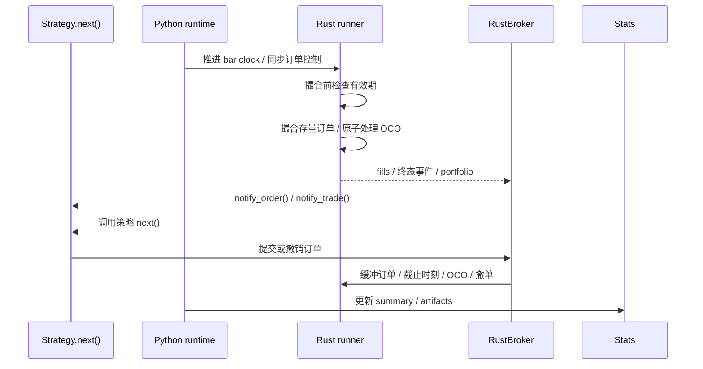

# Runtime 与 Runner

本页对应2026-11-12未发布源码候选；历史发行事实保留在[发布记录](../reviews/2026-11-03-runtime-release.md)。Engine/Lite共用Runtime、Lines、持久指标与执行事实，非BT能力退出Engine根。来源资格与唯一规则见[公共规范](../../../../../docs/系统规范/交易/TradeLearn框架规范.md#stream-first-event-backtest-20261111)。源码、安装包与真实venue分开验收。

trade-learn是事件驱动回测框架。指标保存独立状态，随所属Feed实际事件推进；批量研究组件仍显式使用Pandas，不自动把任意lambda编译为实盘程序。NA实时始终只有一个官方宿主。

## 自动 runner 选择

| 场景 | 自动路径 | 触发条件 |
|---|---|---|
| 单标的 | Rust single-data runner | 合格秒级数组Feed、Rust engine已绑定 |
| 主Feed覆盖全部时间 | Rust multi-data clock runner | 多Feed标准数组且并集等于主Feed日历 |
| 并集含额外时点 | 共同Python事件协调 + 同一Rust matcher | 按真实时间并集逐步推进，不填造OHLCV |
| 自定义broker/Feed | 支持协议内的事件协调 | 缺失协议明确拒绝，不降级为Python撮合 |

用户不显式选择runner。Engine显式`adddata(feeds.PandasData(...))`；Lite可接DataFrame/symbol映射/panel后内部建立Feed。各Feed长度、指标准备和窗口只由真实交付推进；Engine策略len/datetime表示共同批量事件时钟，主Feed结束后仍处理其他Feed。并集时钟不物化“事件数×Feed数”的游标矩阵；同日历Feed复用原时间数组。实时窗口仍有界，不建立批量时间表。

Rust扩展缺失时默认回测明确失败，不静默改Python撮合。当前批量native存储使用Unix秒，subsecond输入在截断前明确拒绝；官方NA纳秒事件路径保持，不据常量名称宣称微秒回测合格。

## 事件顺序



默认 `next()` 新单在下一根 bar 获得撮合机会；启用 close / cheat 配置时使用对应的额外撮合时点。每条 runner 路径共享原生订单控制与终态回传，不另建 Python 撮合循环。Python fallback 同样在成交前执行有效期检查。

Engine的timedelta valid按固定BT目标Feed当前日期换算；数字valid是BT日期序数，0表示DAY。内部/Lite相对秒契约与该入口区别保留。实际共同提交时钟独立记录，不能由旧行情时间代替。撤单、OCO 撤单和过期会更新 broker 状态、待成交数量并触发订单通知。详见[撮合与成交](../internals/matching.md)。

## 为什么不是纯向量化

纯向量化可以很快，但会弱化订单生命周期、成交事件、拒单、撤单、现金和持仓状态回流。trade-learn 保留事件驱动模型，是为了让回测策略更容易迁移到 paper/live broker，同时把真正高频的撮合和状态推进放进 Rust。

## 正式增量策略Runtime

历史0.2.8曾从Engine根公开StrategyRuntime；本轮该非BT导出迁到内部`tradelearn.backtest.event_runtime`。Runtime同步协调构造、参数/data绑定、生命周期、暖机及通知，不启动后台loop。默认Cerebro/Backtest和外部事件驱动复用同一实现；实时装配使用独立NautilusStore，不再通过Cerebro非BT mode参数选择另一套驱动。

```python
from tradelearn.engine import Strategy
from tradelearn.backtest.event_runtime import StrategyRuntime

class Signal(Strategy):
    def next(self):
        # broker决定订单能力与权威持仓；Runtime不维护另一份成交账本。
        if self.data.close[0] > 100:
            self.buy(size=1)

runtime = StrategyRuntime(Signal, feeds={'A': 'bar'}, broker=my_broker)
runtime.start()
runtime.step_market('A', received_bar, kind='bar')
runtime.step_broker(authoritative_order, kind='order')
runtime.stop()
```

`strategy_cls`与已构造`strategy=`互斥；传类时构造即获得feeds。`strategy_args/parameters`显式传参，策略从runtime_context读取symbol/event/ts_event_ns/sequence。Engine和Lite都可绑定同一增量Runtime；Lite的订单便利语法仍受实际broker/venue能力限制，不承诺任意策略类原样互换。

### 事件、时钟与可见数据

- 同一owner线程顺序调用`start/step_market/step_broker/stop`；start/stop幂等，stop后禁止步进，策略或指标异常后禁止继续运行。没有内部轮询或异步loop。
- `bar`含timezone-aware ts及有效OHLCV；同symbol倒序bar拒绝。相同时间的多事件均按调用顺序消费，不隐式去重、补齐或等待其他symbol；跨symbol只见已交付prefix。`tick`保留原quote对象及ts_event，不伪造OHLCV、不增长bar游标；倒序tick时间保留给上层来源保护判定。
- 每symbol独立有界bar窗口，`capacity`默认4096；`line[0/-1]`、`to_series()`和独立history.window/Lite.window仅见已交付窗口，无未来行。history按需物化，无调用者不构造DataFrame。指标完整计算历史不扩大这些公开视图。
- broker回报在调用`step_broker`的位置同步通知，不等待下个bar。支持order/trade种类及同策略owner核验；可在start前传入已核恢复通知，业务start不能先于未决恢复。Runtime不推造Accepted、持仓、费用或盈亏；重复/乱序回报及订单经济状态由broker映射规范化。
- 外部驱动必须显式绑定symbol与单一事件来源；NA使用独立`tradelearn_runtime.NautilusStore`，不启用旧polling fallback。Runtime只处理调用者实际交付的事件。

### 指标计算契约

来源资格和参数/种子/NaN语义唯一见[指标指南](../guides/indicators.md)；TA-Lib默认，TV/PyneCore与TDX按固定上游合格子集，PTA退出。FunctionIndicator.bind_stream为每调用创建独立binding；配置后的minimum_period/output_names决定暖机和输出数量，多输出共享一次更新，重复读取不推进。

共享Indicator声明lines/params，支持逐Bar next/prenext/nextstart与嵌套状态。Engine/Lite是同一基类。持久来源图必须在交付前定义，开始消费后新建需要reset/replay，不隐式全历史重算。指标在所属Feed新Bar时更新；时钟前进但该Feed未有新Bar时不补更新。跨Feed函数/Line算术拒绝隐式位置对齐。

任意batch-only FunctionIndicator不能冒充实时指标。高级内部`runtime.prefix(func, line, history='full'|'window')`仍是调用者显式选择的因果Pandas前缀计算，非自动编译器；full有prefix_history_limit，window明确改变算法定义。达到预算、计算失败或状态污染后失败关闭，不截断种子后继续。

stop/finally对每个持久binding恰好一次reset/close，保留输出历史；业务与cleanup同时失败保原业务异常，附加清理诊断。单个backend.close失败仍释放其他binding。用户stop保留，不靠垃圾回收释放native全局设置租约。图数量受max_indicators/max_plans预算限制，历史不足或非法输入拒绝，不补未来数据。

## 默认路径与观察 API

此前0.2.8只把EventRunner/paper/live接入正式Runtime，默认Rust研究路径仍独立调度；不能把上一轮验收外推为默认完整统一。0.2.9将默认研究的构造、setup/init/start、预载游标/指标/warmup、业务/组件回调和stop也纳入同一协调器，Pandas研究批量计算与Rust匹配保留。新中性观察接口见[Strategy observers](../guides/strategy-observers.md)，不依赖任何SDK或执行引擎。SDK产品实现及双方联调不在通用hook实现中冒充完成。

0.2.9的`step_market_batch(events)`显式表达同timestamp原子批次；默认研究合步、标准实盘逐到达的差异及异常清理合同见[观察API的市场批次与异常结束](../guides/strategy-observers.md#市场批次与异常结束)。Runtime本身不新建loop、不等网络或缺失标的，预验证失败不部分推进feed。

<a id="runtime-install"></a>

### 安装与原生扩展

历史已发行版本使用 `pip install trade-learn==0.2.9`；它不包含本文全部未发布变化。本轮应从TL4最终SHA收据指向的本地wheel安装，按实际ABI/平台验证，不用旧PyPI版本冒充本轮通过。源码构建沿 pyproject/maturin 与 Cargo.lock；不能复用或改名旧扩展。安装后版本应满足 `tradelearn.__version__ == _rust.tradelearn_rust_version() == '0.2.9'`，observer capability 为 1。历史候选和验收阶段见[发布记录](../reviews/2026-11-03-runtime-release.md)，不作为当前安装步骤。

<a id="nautilus-logging"></a>

## Nautilus 与策略日志

0.2.9默认包含通用桥和策略日志组件；可选Na执行依赖预发行框架，作为实验性接入路径维护。当前未发布源码的基础安装包含本地记录器，不安装AWS SDK或Nautilus；SQS SDK并入源码`[nautilus]`，在源码根目录安装 `pip install ".[nautilus]"` 或对应本地wheel。已发布PyPI0.2.9的依赖保持不变，保持原extra定义；使用桥必须在Python3.13或3.14安装 `trade-learn[nautilus]`，目前精确依赖官方 `nautilus_trader==2.0.0rc7`（预发行版，Python>=3.13）。其它Python安装该extra会安装SDK但按marker跳过NT，不能使用Na桥；实际桥入口明确拒绝，不自动fallback。导入不连接账户、不创建交易节点或自动发送，日志默认按调用者显式配置开启。

```bash
python -m tradelearn_runtime.support
```

该命令从已安装固定版本的包文件清单发现适配器，并与真实官方wheel生成的唯一official_adapters.json核对；出现名单外目录拒绝冒称官方清单。此展示检查不用于阻止用户注册独立适配器，也不是官方二进制认证。该命令不导入adapter、读取账户或建立网络。下面由已审官方Linux CP313 wheel的公开factory接口核出；“内置”是可发现代码范围，不是每个来源的TL桥、订单、paper、实盘或平台均已验收。行情源不因此成为交易券商，sandbox也不证明其它adapter支持模拟账户。私有cTrader不在官方包或本库内。

| 内置包 | 官方公开接口形态 | TL逐来源业务验收 |
|---|---|---|
| `architect_ax` | 行情与执行 factory | 未逐来源验收 |
| `betfair` | 行情与执行 factory | 未逐来源验收 |
| `binance` | 行情与执行 factory | 未逐来源验收 |
| `blockchain` | 仅行情 factory | 未逐来源验收 |
| `bybit` | 行情与执行 factory | 未逐来源验收 |
| `coinapi` | 仅行情 factory | 未逐来源验收 |
| `coinbase` | 行情与执行 factory | 未逐来源验收 |
| `databento` | 仅行情 factory | 未逐来源验收 |
| `deribit` | 行情与执行 factory | 未逐来源验收 |
| `derive` | 行情与执行 factory | 未逐来源验收 |
| `dydx` | 行情与执行 factory | 未逐来源验收 |
| `hyperliquid` | 行情与执行 factory | 未逐来源验收 |
| `interactive_brokers` | 行情与执行 factory | 未逐来源验收 |
| `kraken` | 行情与执行 factory | 未逐来源验收 |
| `lighter` | 行情与执行 factory | 未逐来源验收 |
| `okx` | 行情与执行 factory | 未逐来源验收 |
| `polymarket` | 行情与执行 factory | 未逐来源验收 |
| `sandbox` | 仅模拟执行 factory | 未逐来源验收 |
| `tardis` | 仅行情 factory | 未逐来源验收 |

通用桥使用内部共同Runtime，Market/Limit/Stop/StopLimit/Trailing与DAY/GTC/IOC/FOK按实际来源资格接入，GTD新准入拒绝（原生过期边界未合格）；实际venue的订单、数量、TIF及产品限制仍需单独验证，不支持控制字段明确拒绝。桥要求显式账户、instrument、venue路由、策略身份及持久intent路径；不支持用per-order client覆盖绕过已验证路由。只有对同账户/策略/标的已验证的仓位才能reduce-only关闭；未知发送先查原订单，不自动重发或以空仓清除未决意图。

已进行Mac arm64及Linux x86_64 CPython3.13的本地无账户仿真、绑定拒绝、部分成交、重放及恢复验证；Windows和各真实venue的业务验收未完成。安装官方wheel成功不替代以上验收，也不构成交易损失保证。关闭日志或不接商业监控不关闭执行保护；发送需调用方明确配置受限授权，监控接收/归档/计算/展示是独立服务，不代策略决策。

接线入口为 `tradelearn_runtime.execution.create_execution_host`；需保留真实native缓存及broker事件作为执行/账户事实来源，不从logger生成成交或财务结果。自定义宿主可通过 `get_execution_host_class(logging_enabled=...)` 保留业务hooks；不把继承当恶意代码沙箱。

### 本地记录与发送的平台条件

记录器需要与Python ABI/操作系统匹配的本包原生扩展。Unix沿文件与目录同步发布；现代Windows/NTFS使用WRITE_THROUGH文件、FlushFileBuffers及同目录原子命名操作，不模拟Unix目录fsync、不跨盘复制降级。要求系统提供FILE_ID_INFO与现代重命名语义；超出可表达身份范围明确拒绝、不截断文件ID。进程崩溃/恢复和硬件断电是不同范围，不据测试宣称所有存储硬件断电无损。

日志状态目录由调用方提供。Windows按真实当前owner/SYSTEM/Administrators DACL验证，不把POSIX 0600数字当ACL；已有或最近存在父目录的权限不合格时，TradeLogger在任何状态文件/线程前拒绝，未启用发送也一样。SDK不自动修改已有ACL。建议使用用户受保护的LocalAppData私有子目录；不要把共享项目目录作为账户日志目录。

```python
import os
from pathlib import Path
from leafquant_monitor import MonitorSettings, TradeLogger

private_root = Path(os.environ.get("LOCALAPPDATA", str(Path.home() / ".local" / "state")))
settings = MonitorSettings("LOCAL", "example", "offline", str(private_root / "trade-learn" / "example"),
                           account_source="external")
logger = TradeLogger(settings)
try:
    logger.record("lifecycle", {"state": "started"})
    logger.flush()
finally:
    logger.close()
```

该例只写本地事实，不连接账户、不发送。远程发送另需显式受限配置/授权、受信receipt origin与archive binding；标准配置拒绝公共可读的凭据文件，受信内存provider无需被迫落地秘密。SQS ACK不代表原文可删除：完整、正确绑定与摘要的归档proof先持久登记，才允许按文件身份退休；Windows在同目录保留可恢复tombstone，删除失败可重启继续，不重发已证明退休原文。source-only传输角色共用纯stdlib平台薄层，不强加Na或native依赖。

当前源码启用默认SQS发送但缺SDK时，TradeLogger在创建Recorder/state/线程前明确拒绝并给出匹配本地wheel的`[nautilus]`安装指引。受信注入sender factory/client不强制SDK；未配置发送时不加载SDK，执行身份与恢复保护不依赖日志/远程监控。

当前源码默认安装含tqdm/TA-Lib，公开extra为research（研究库及JupyterLab/AI Lite/Skills/MLflow）、nautilus（官方NT+SDK）、tl-store（当前按需cTrader组件，仅已验证CPython3.13 Mac arm64/Linux x86_64）。TL+cTrader推荐目标命令为 `pip install "trade-learn[nautilus,tl-store]"`，由extra自动锁定实际adapter发行包，实际依赖本地构建的tl-store发行候选；新组合仍是未公开发行候选。完整研究工具使用research；CLI仅new/lab/doctor，lab只启动Jupyter；TL MCP和MLflow服务包装已删除，实验默认本地SQLite记录；开发/文档工具通过uv dependency-groups。已发0.2.9保持历史安装契约。
